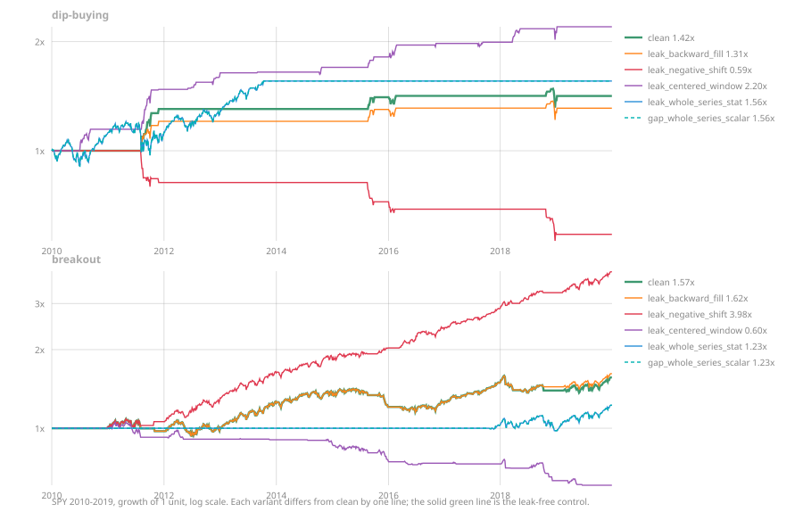

# leakcheck

[](https://github.com/mkingjay3/leakcheck/actions/workflows/tests.yml)


A static checker for lookahead bias in pandas/numpy backtest code. It reads
the syntax tree of each file without importing or running it, and uses only
the standard library.

A backtest leaks when a decision at row *i* uses data from later rows.
leakcheck detects four patterns that can be identified from the code alone:

- `bfill()` / `backfill()`: fills a gap with the next known value
- `shift(-n)`: pulls in rows from ahead of the current one
- `rolling(center=True)`: half the window is future rows
- a whole-series statistic combined back into the series it came from (the
  main focus of the project)

Each finding reports its **reach**, the number of future rows the line reads.
`shift(-3)` reaches 3 rows, a centered window of 252 reaches 126, and `bfill`
and whole-series statistics reach the entire series. `unknown` means the
window size isn't readable from the syntax and should not be assumed small.
As the measurements below show, reach turned out not to predict what a leak
costs.

The fourth pattern looks like this:

```python
df = (df - df.min()) / (df.max() - df.min())
```

`min()` and `max()` are computed over the whole column and broadcast back
across it, so row 0's normalized value depends on a high that may not occur
for years. The line looks like normal preprocessing, and it causes three of
the four planted-lookahead examples in freqtrade-strategies, which I used as
ground truth.

The rule only fires when the statistic is combined arithmetically with its
own series. `np.mean(r) / np.std(r)` produces a scalar and is not flagged.
Neither is `{"min": s.min(), "p5": s.quantile(.05)}`, which mentions `s`
twice without combining it. Fills are checked as well:
`shift(1, fill_value=close.mean())` writes a whole-series value into specific
rows.

## Installing it

No installation is needed. leakcheck is a single file that uses only the
standard library and requires Python 3.9+.

```
git clone https://github.com/mkingjay3/leakcheck
python3 leakcheck/finder.py <file_or_directory> ...
```

## Running it

```
$ python3 finder.py sample.py
sample.py:7:27: high  backward-fill
   7 | df['close'] = df['close'].bfill()
     |                           ^^^^^^^ backward fill pulls future values into earlier rows
sample.py:14:32: high  negative-shift
  14 | df['next_close'] = df['close'].shift(-1)
     |                                ^^^^^^^^^ shift(-1) pulls 1 future row backward
sample.py:24:29: low  whole-series-stat
  24 | df['norm'] = (close - close.min()) / (close.max() - close.min())
     |                             ^^^^^ min() over the whole series is combined back into that series
sample.py:24:45: low  whole-series-stat
  24 | df['norm'] = (close - close.min()) / (close.max() - close.min())
     |                                             ^^^^^ max() over the whole series is combined back into that series

scanned 1 file in 0.00s

  2 high      2 low
  2 shift calls, 0 unresolvable (0%)
```

Confidence tiers are colored in a terminal and plain when output is
redirected, so logs contain no escape codes.

| flag | |
|---|---|
| `--format {text,json,sarif}` | caret output for people, flat JSON for scripts, SARIF 2.1.0 for GitHub |
| `--min-confidence {high,low}` | lowest tier to report; `high` removes low-tier findings from both output and exit code |
| `--exclude PATTERN` | skip paths matching a glob (repeatable) |
| `--quiet` | omit the summary |

The exit code is 1 if anything is found and 0 otherwise, so it works in a
commit hook or CI job:

```
python3 finder.py --min-confidence high --quiet src/ || echo "blocked"
```

Directory scans skip `venv`, `site-packages`, `.git` and `node_modules`.
Files that can't be read or parsed are reported on stderr and counted in the
summary: `scanned 589 of 590 files` means one file was not analyzed. `shift`
calls with an argument that can't be resolved from the syntax are also
counted, so that blind spot is visible.

### GitHub code scanning

`--format sarif` outputs SARIF 2.1.0, which GitHub supports natively. Once
uploaded, findings appear as inline annotations on pull requests and in the
repository's Security tab:

```yaml
- run: python3 finder.py --format sarif --quiet . > leakcheck.sarif || true
- uses: github/codeql-action/upload-sarif@v3
  with:
    sarif_file: leakcheck.sarif
```

`|| true` is needed because a nonzero exit would otherwise skip the upload
step. High-confidence findings use SARIF level `error` and low-confidence
findings use `note`, so the less reliable tier doesn't fail pull requests by
default. Each result has a fingerprint based on its rule and source line, so
it is tracked as the same finding when edits shift its line number.

Consumers can group and suppress by the four rule ids: `backward-fill`,
`negative-shift`, `centered-window` and `whole-series-stat`. `run_tests.py`
verifies that the SARIF output parses and that its column ranges point at the
flagged call, since GitHub accepts malformed SARIF without error and then
displays nothing.

To suppress a finding, add `# leakcheck: ignore` to the line. The main use is
machine learning labels:

```python
df['target'] = df['close'].shift(-1)  # leakcheck: ignore
```

A label is supposed to look ahead, and it's written the same way as the bug,
so the author has to mark it.

## How well it works

I tested against three corpora: 19 repos and 1663 files in total. The rules
were developed against the first. The other two were held out until the rules
were finished, one made of libraries and one of strategies. I split them that
way because the first held-out run had mixed up "unseen code" with "library
code".

Every finding in all three was reviewed by hand and recorded with a verdict
and a one-line reason, so anyone can check the numbers:

```
                 files   high   low   leaks   verdicts in
corpus             590      2     9   11/11   audit.json
holdout            928     11    25   18/36   holdout-audit.json
strategies         145      0     1    0/1    strategies-audit.json
                                      29/48

python3 audit.py report
AUDIT_CORPUS=holdout AUDIT_FILE=holdout-audit.json python3 audit.py report
```

The tool scores 11/11 on the corpus it was built against and 18/36 on code it
hadn't seen. The held-out number is the meaningful one, and the gap between
the two was the most useful result of the project.

Recall is measured separately by injecting leaks into real code:

```
python3 recall.py        # 153/153 injected leaks caught
```

`recall.py` takes real call sites from the corpora (a positive `shift`, an
`ffill`, a `rolling` window, a windowed aggregate next to its own series),
mutates each into a definite leak, and checks that the tool reports it. Any
miss is a false negative in code not written for this project. It found three
misses, all of the form `returns.mean() / returns.rolling(20).std()`. They are
fixed and covered by a test case.

For independent ground truth,
`corpus/freqtrade-strategies/user_data/strategies/lookahead_bias/` contains
four strategies with deliberately planted lookahead bias and a readme naming
each bug. leakcheck catches three. It misses `wtc`, which leaks through
sklearn's `MinMaxScaler` instead of a pandas aggregate.

```
python3 run_tests.py     # 37 cases, precision and recall per tier
```

The 37 test cases score 100% precision and recall (15 findings, no false
positives or negatives). This is the least informative number here because
the cases were written to define the rules. The corpus verdicts and the
injected-leak recall could have failed, and the held-out corpus partly did.

### Reproducing the numbers

The corpora are gitignored clones. `corpora.json` pins each repo to an exact
commit and records the finding counts for that commit:

```
python3 fetch_corpora.py            # clone all nineteen at their pinned commits
python3 fetch_corpora.py --check    # fail if a commit or a count has drifted
```

Without pinning, results like "590 files, 11 findings" couldn't be verified
later.

### What the held-out corpora revealed

Each held-out corpus exposed a problem the earlier ones couldn't.

The library corpus showed that the broadcast rule fired on *any* mention of
the series, so `s.quantile(.05)` receivers and `len(s)` were treated as
broadcasts. quantstats alone produced 24 of these. It also showed that the
real leaks in `ta` were being caught for the wrong reason, which led to a
separate rule for `fill_value=`.

The strategy corpus crashed the tool with a `RecursionError` on eight
NostalgiaForInfinity files, one of them 79k lines long. After that was fixed,
it produced 52 high-confidence findings, all `rolling(center=True)`, a
pattern that hadn't fired once in the previous 1518 files. All 52 were the
same correct idiom: a centered window of 5 followed by `.shift(2)`, where the
shift exactly compensates. A pattern can be absent from two corpora and make
up all the output of a third.

## What a leak is worth

The checker identifies leaky lines. `cost.py` measures how much each leak
changes a backtest. It runs one honest strategy and five variants, each
differing from the control by one line, over ten years of daily SPY closes
pinned in the development corpus.

The variants in `cost_cases/` are ordinary pandas-style code. finder.py
analyzes them statically, and `cost.py` executes them against a
standard-library `Series`, so the flagged line and the resulting Sharpe ratio
come from the same source.



```
dip-buying  (hold while depth < 0.3)
  strategy                  leakcheck                              Sharpe    CAGR   maxDD   final  vs clean
  clean                     -                                        0.66    3.5%  -11.7%    1.4x         -
  leak_backward_fill        backward-fill L12 (whole series)         0.52    2.7%  -11.7%    1.3x     +0.8x
  leak_negative_shift       negative-shift L16 (1 row)              -0.90   -5.2%  -43.6%    0.6x     -1.4x
  leak_centered_window      centered-window L12 (126 rows)           1.23    8.2%   -6.7%    2.2x     +1.8x
  leak_whole_series_stat    whole-series-stat L16 (whole series)     0.47    4.5%  -19.4%    1.6x     +0.7x
  gap_whole_series_scalar   -                                        0.47    4.5%  -19.4%    1.6x     +0.7x

breakout  (hold while depth > 0.7)
  clean                     -                                        0.52    4.6%  -18.8%    1.6x         -
  leak_backward_fill        backward-fill L12 (whole series)         0.56    5.0%  -18.9%    1.6x     +1.1x
  leak_negative_shift       negative-shift L16 (1 row)               1.53   14.8%   -7.1%    4.0x     +2.9x
  leak_centered_window      centered-window L12 (126 rows)          -0.84   -4.9%  -42.7%    0.6x     -1.6x
  leak_whole_series_stat    whole-series-stat L16 (whole series)     0.36    2.1%  -13.0%    1.2x     +0.7x
  gap_whole_series_scalar   -                                        0.36    2.1%  -13.0%    1.2x     +0.7x
```

Both entry directions are run because a single direction would hide the first
two results below.

**Leaks make results arbitrary, not just inflated.** `shift(-1)` nearly
triples the Sharpe of the breakout rule and flips the sign of the dip-buying
rule. The centered window does the reverse: it helps the dip-buyer and wrecks
the breakout. The same leak on the same data leads to opposite conclusions
depending on the strategy. The common belief is that lookahead bias makes a
backtest look better. In practice it disconnects the result from the
strategy, and the direction is effectively random.

**Reach doesn't predict cost.** The one-row leak moved results the most in
both directions, while `bfill` and the whole-series statistic, both with
unlimited reach, moved them the least. A one-row leak applied to every row
matters more than a whole-series leak that only shifts a threshold. Most
people would guess the opposite, and the reach number the tool prints could
reinforce that guess.

**The known gap costs the same as the detected bug.** `leak_whole_series_stat`
is flagged. `gap_whole_series_scalar` is the same calculation with the
statistic assigned to a variable first, and the tool misses it. Both produce
identical results in both directions, so the gap described under Limitations
is the same bug in a slightly different form.

```
python3 cost.py           # the table
python3 cost.py --svg     # also rewrite docs/cost.svg
```

The chart is generated as hand-built SVG without a plotting library, so the
repository stays dependency-free.

Scope: one instrument, one decade, one strategy family and two entry rules.
The results show that these leaks can change a backtest far more than the
effect being measured, and in an unpredictable direction. They don't
establish a general multiplier, and a different strategy would produce a
different ordering.

## Compared with running the backtest twice

Another way to catch lookahead bias is dynamic: run the backtest over
different slices of history and check whether the result for a given bar
changes once later bars are added. freqtrade's lookahead-analysis command
uses this approach and is the closest prior work. The two approaches have
opposite failure modes:

|  | leakcheck (static) | re-running the backtest (dynamic) |
|---|---|---|
| needs | the source file | price data, a runnable strategy, a config |
| cost | 590 files in 0.9s | minutes per strategy |
| finds | the four syntactic shapes, wherever they appear | any leak that changes a result, whatever caused it |
| misses | leaks through a library call or a variable | leaks that do not change the result on the data at hand |
| false positives | 47, in six shapes | a strategy that is legitimately path-dependent |

The freqtrade ground truth shows the difference. leakcheck misses `wtc`
because it leaks through sklearn, while a dynamic check would catch it by
observing the changed output. On the other hand, a dynamic check only catches
leaks that affect results on the data provided, and the table above includes
leaks with almost no effect on a given strategy.

The two approaches complement each other. The main advantage of the static
check is that it runs on every commit in under a second, on code that has
never been executed.

I haven't run the two tools head to head, so there's no confusion matrix.
That would require installing freqtrade with its data and is the obvious next
measurement.

## Limitations

There are three known weaknesses, each measured.

**It can't resolve 19% of the `shift` calls it sees** (47 of 246 on the
development corpus). If the shift amount is a parameter, a computed
expression or a name assigned more than once, the call is neither cleared nor
flagged. It is counted instead, and the count is printed after every run so
the blind spot is visible next to the findings.

**False positives fall into six categories.** All 47 non-leaks across the
three corpora were reviewed and categorized:

```
15  post-run reporting     a stat computed after the backtest, for a chart or
                           a summary table, never fed back into a decision
13  no time axis           weights/weights.sum(), a fixed sine kernel, a mean
                           across option contracts at one instant, a Q-table
 9  bounded out of sight   already sliced to a training window, or bounded by
                           the caller: _mad handed to rolling().apply()
 4  fixtures and synthetic data    a price frame built for a unit test
 3  index metadata         min() of a date index, used to truncate a range
 3  deliberate lookahead   shift(-48) building a supervised label
```

The first two categories depend on meaning rather than syntax.
`weights / weights.sum()` and `close / close.mean()` have the same structure,
but the first is a portfolio normalization with no time axis and the second
is a leak. A syntax-based rule can't reach zero false positives here without
missing real leaks, which is why these findings are in the low tier.

**Some leak types aren't detected.** A whole-series statistic stored in a
variable and applied later is a real leak that the tool misses:

```python
vol = df['returns'].std()
df['zscore'] = df['returns'] / vol
```

Detecting this requires knowing whether a subscript target is a DataFrame or
a dict, since `df['x'] = ...` and `d['x'] = ...` look the same. An earlier
version that tried produced 26 false positives on the development corpus and
caught no real leaks, so I removed it. The five missed shapes are kept as
`tests/cases/gap_full_series_*.py`, and `run_tests.py` prints them on every
run so the 100% score isn't mistaken for complete coverage.

`cost_cases/gap_whole_series_scalar.py` uses this exact shape and produces
the same backtest as the detected version in both entry directions, so this
gap matters as much as the detected bug.

Other misses found during the census: leaks through sklearn scalers or other
library calls, and bounding that happens inside a function the tool can't
analyze. The tool also can't tell a strategy from a test fixture, which
explains most of the high tier's 2 of 11 on held-out code.

Check the summary line, not just the exit code.

## The files

```
finder.py          the checker
run_tests.py       case suite, with the known gaps printed every run
recall.py          injects leaks into real code and checks they're caught
cost.py            measures what each class of leak is worth, in Sharpe
cost_cases/        one honest strategy and five one-line-leaked variants,
                   plus the standard-library Series they run against
docs/cost.svg      the equity curves, regenerated by cost.py --svg
audit.py           record a hand verdict on every finding in a corpus
fetch_corpora.py   clone the corpora at their pinned commits
corpora.json       the pins, and the counts they produce
notes.txt          the running log: every change, the measurement before and
                   after it, and why things were left alone
baseline.txt       the numbers, per corpus, with dates
FINDINGS.md        the write-up: prevalence, false positive shapes, and what
                   each class of leak is worth
review-notes.md    an earlier writeup, kept for the two conclusions it got wrong

.github/workflows/tests.yml
                   the case suite on 3.9/3.11/3.12, a SARIF upload to the
                   Security tab, and the corpora recheck on demand
```

`finder.py` contains the rules, reporting and CLI. All rules are declared in
a table at the top of the file that `visit_Call` dispatches through. Adding a
rule means adding a table entry and the method it names, and the full rule
list can be read in one place.
